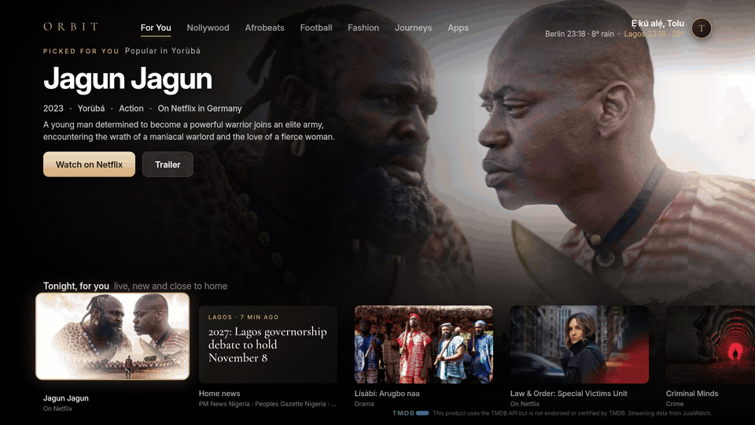
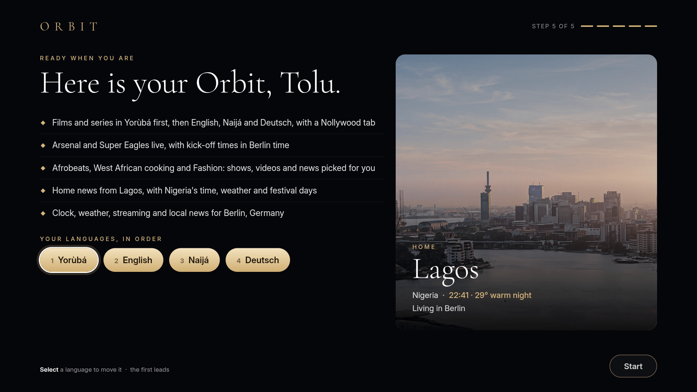
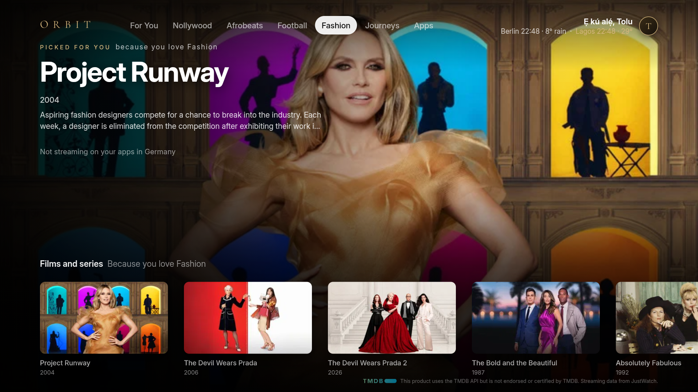
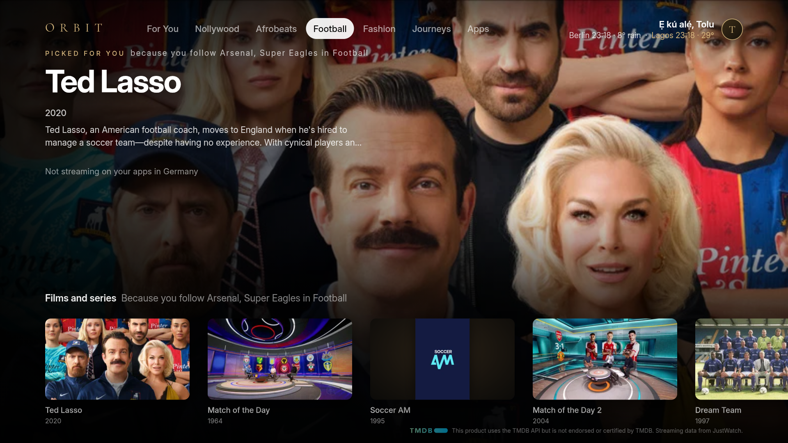

# Orbit

[](docs/media/orbit-demo.mp4)

[Watch the demo (79 seconds, with sound)](docs/media/orbit-demo.mp4)

A home screen for Fire TV that is shaped by the people who watch it. You build and install it yourself with your own free keys, and everyone who uses the TV sets it up for themselves with the remote: where home is, which languages feel like home, where they live now and what they love. From then on films, live sport, news, radio, videos and travel follow those choices, and Orbit keeps learning from what each person watches. Everything it learns stays on the TV.

Orbit is a personal, non-commercial project. It is not affiliated with Amazon or any service it shows (see [Disclaimer](#disclaimer)).


## Features

- **Setup with the remote.** Five big-type screens: your name, where home is (a sunlit globe turns to the country you choose; pick up to three home towns or search for any town on Earth), your languages and the city you live in (guessed from the TV's clock, then confirmed), what you love, and a plain-language summary. The on-screen keyboard types accents and tone marks.
- **Up to six people per TV.** The circle in the top bar opens **Who's watching**, **Add a person** and **Change my setup**. Each person has their own home, picks and history.
- **Cinema, the home.** For You, your home film industry, up to three of your loves, Journeys and Apps. For You starts with "Tonight, for you": live matches of the sport you follow, a film picked for you, new videos for your loves, news from your home town and a live stream. Every row says why it is there, and kick-off times are in your own time zone. Films and series come from TMDB in your languages, with where to watch them in the country you live in.
- **It keeps learning.** Opens and minutes watched raise a love's weight, a love left untouched for a month fades, and "Orbit noticed" offers an interest you keep watching but never chose. Learning is per person.
- **Journeys.** Choose a place on a globe, search for any town, or pick what is live right now or waking up at sunrise, then walk it, drive it, eat there, catch a festival or watch a live camera, with the place's own time, weather and sunrise around the picture. Footage comes from YouTube creators.
- **Home Mode.** "Feels like <your home country>": the time at home, a greeting in your language (where Orbit has a checked one), the weather in your home town, festival days, home news, live home channels, and home radio.
- **Screensaver.** The Earth from low orbit with the real sun and city lights.

| | |
|---|---|
|  |  |
|  |  |
|  |  |
|  |  |

The example person in these pictures and the demo is Tolu, from Lagos, who lives in Berlin and watches in Yorùbá, English, Naijá and German. The pictures are real captures from the reference TV. Film art, photographs and logos in them come from third-party services and belong to their owners; see [Media in this repository](THIRD_PARTY_NOTICES.md#media-in-this-repository). The demo's music is "Bathed in the Light" by Kevin MacLeod (incompetech.com), licensed under CC BY 4.0.

## Requirements

- A Fire TV running **Fire OS 6 or later** (tested on Fire OS 7, Android 9 based) with developer options turned on. Orbit was built and measured on a 32-inch JVC smart TV with Fire OS 7 (armeabi-v7a, 1.5 GB RAM).
- A computer (macOS, Linux or Windows) with **JDK 17**, the **Android SDK** command-line tools (`platform-tools`, `build-tools;34.0.0`, `platforms;android-35`) and Git, on the same network as the TV.
- Two free personal keys: a **TMDB** API key and a **YouTube Data API v3** key. Orbit runs without them, but films (TMDB) and Journeys and love videos (YouTube) stay empty.

## Install

Orbit is not in the Amazon Appstore: you build it on your computer and install it on the TV over your Wi-Fi. The first time takes about 45 to 60 minutes in all, most of it waiting for downloads. Each step links to the full instructions in [docs/SETUP.md](docs/SETUP.md).

1. **Tools on your computer** (about 15 minutes). Install JDK 17, the Android SDK command-line tools and Git. [Step 1](docs/SETUP.md#1-tools-on-your-computer)
2. **Developer mode on the TV, and connect** (about 5 minutes). Turn on ADB debugging and unknown sources, then `adb connect` to the TV's IP address. [Step 2](docs/SETUP.md#2-prepare-the-fire-tv)
3. **Your two free keys** (about 10 minutes). A TMDB API key and a YouTube Data API v3 key, both for personal use. [Step 3](docs/SETUP.md#3-get-your-own-two-free-keys)
4. **Configure `local.properties`** (about 2 minutes). Clone this repository, copy `local.properties.example` and paste in your SDK path and both keys. [Step 4](docs/SETUP.md#4-configure)
5. **Build, sign and install** (about 10 minutes, longer on the first build). One Gradle build, one `apksigner` command, one `adb install`. [Step 5](docs/SETUP.md#5-build-sign-and-install)
6. **Permissions and screensaver** (about 2 minutes). Four `adb shell` lines, then open Orbit once from Apps on the TV. [Step 6](docs/SETUP.md#6-permissions-and-the-screensaver)
7. **First setup on the TV** (about 3 minutes per person). Your name, home, languages and loves, with the remote. Films and live sport arrive over the next few minutes. [Step 7](docs/SETUP.md#7-first-setup-on-the-tv)

### Already set up? Rebuild and install

```
./gradlew assembleRelease
apksigner sign --ks ~/.android/debug.keystore --ks-pass pass:android --key-pass pass:android \
  --ks-key-alias androiddebugkey --out orbit.apk app/build/outputs/apk/release/app-release-unsigned.apk
adb install -r orbit.apk
```

## Use it

Everything is done with the Fire TV remote. The full guide is [docs/USAGE.md](docs/USAGE.md).

- **The remote.** Arrows move, Select opens, Back goes one step back, Menu switches between Cinema and the channel wall. [The remote](docs/USAGE.md#the-remote)
- **Your home.** Cinema opens on For You: tonight's live sport, a film picked for you, home news and rows for your loves. Rest on a title to see its trailer. [Your home](docs/USAGE.md#your-home-cinema)
- **Who's watching.** The circle with your initial (top right) switches people, adds a person or changes your setup. [Who's watching](docs/USAGE.md#whos-watching)
- **Journeys.** Pick a place on the globe or search any town, then walk, drive or eat there. [Journeys](docs/USAGE.md#journeys)
- **Home Mode.** The "Feels like <your home country>" card in the Home row at the bottom of For You. [Home Mode](docs/USAGE.md#home-mode)
- **Channel wall.** Menu opens live channels from your home country and the apps on the TV. [Live channels and radio](docs/USAGE.md#live-channels-and-radio)

Your keys are built into the APK you make. Keep that APK to yourself, and run `tools/check-secrets.sh` before every commit and push.

How it is built: [docs/ARCHITECTURE.md](docs/ARCHITECTURE.md). Contributing: [CONTRIBUTING.md](CONTRIBUTING.md). Reporting a security issue: [SECURITY.md](SECURITY.md).

## Privacy

Orbit has no server and no account. Profiles, history, learned tastes and caches are stored on the TV only (the app's private storage and its WebView storage) and are never uploaded. Uninstalling Orbit removes them.

To show its content the TV contacts these services directly. Each request carries what the service needs to answer (for example a city name, coordinates, a language or a search term), your own API key where one is needed, and a User-Agent naming Orbit and a contact (the project page, or the email you set as `contact.email`):

| Service | What for |
|---|---|
| TMDB (api.themoviedb.org, image.tmdb.org) | Films and series, artwork, trailers, where to watch (TMDB's watch-provider data comes from JustWatch). Needs your key. |
| YouTube Data API (googleapis.com) and YouTube embeds and thumbnails (youtube.com, i.ytimg.com) | Journeys footage, videos for loves, live channels. The search needs your key; videos play in the YouTube embedded player. |
| Google News RSS (news.google.com) | Headlines for loves and home towns, in each person's language and country edition. |
| ESPN public scoreboard endpoints (site.api.espn.com, site.web.api.espn.com) and Cricinfo live scores (static.cricinfo.com) | Live and upcoming matches. These are unofficial public endpoints and may change or stop without notice. |
| Jolpica (api.jolpi.ca) | Formula 1 calendar and standings. |
| The Race RSS (the-race.com) | MotoGP news. |
| Open-Meteo (api.open-meteo.com, geocoding-api.open-meteo.com) | Weather, sunrise and sunset, and finding places by name. |
| Nager.Date (date.nager.at) | Public holidays for home countries. |
| Wikipedia and Wikidata (en.wikipedia.org, wikidata.org, upload.wikimedia.org) | Place summaries, native place names and photographs, credited on screen. |
| Radio Browser (radio-browser.info) | Home radio stations. |
| Netflix public Top 10 file (netflix.com) | What is popular in the country you live in. |
| TVmaze (api.tvmaze.com) | Posters for Top 10 titles TMDB does not match. |
| ipwho.is and ipapi.co | The country (and, for the sky, the approximate location) the TV's connection is seen from, so app hand-offs and the sky fit where the TV is. |

Streaming apps you open from Orbit are the apps themselves; Orbit only starts them.

## Limitations

- **The Home button.** Fire OS does not let any app replace Amazon's home. Orbit takes over each time the TV wakes, and the remote's Home button still goes to Amazon's home.
- **Performance on low-end TVs.** The reference TV's GPU is fill-bound, so the pages are plain DOM and the globe is pre-rendered. On that TV Cinema's shelves reach about 25 ms per frame at the 90th percentile and 230 to 245 MB of memory with art-heavy rows; setup and Journeys are lighter. `tools/measure.sh` measures frame times and memory on your TV.
- **Free allowances.** The YouTube Data API allows about 100 searches a day for a free key. Orbit stops at 80 per Pacific-time day and caches what it finds, so new videos can pause until the next day.
- **Unofficial sources.** ESPN and Cricinfo endpoints are not public APIs and can break at any time.
- **Rights follow the TV's country.** What a streaming app offers depends on its own rules for the country the TV is in. Orbit never bypasses them.
- **Data that needs updating.** Bundled festival days for countries Nager.Date does not cover are fixed per year (see SETUP).

## Disclaimer

Orbit is an independent, non-commercial project. It is not affiliated with, endorsed by or sponsored by Amazon, Netflix, Google or YouTube, TMDB, JustWatch, ESPN, Cricinfo, or any other company or service named in this repository or shown in the app. All trademarks, logos and content belong to their owners. You are responsible for using each service within its terms: get your own keys, respect each API's rate limits and attribution rules, and use TMDB under its terms for personal, non-commercial use. This product uses the TMDB API but is not endorsed or certified by TMDB.

## Credits

Bundled fonts, code, images and data, with their licences and the attribution they require, are listed in [THIRD_PARTY_NOTICES.md](THIRD_PARTY_NOTICES.md). In short: Inter, Cormorant Garamond, Unbounded, Space Grotesk and Space Mono (SIL Open Font License 1.1); Three.js (MIT); Earth textures from NASA (public domain); Milky Way panorama by ESO/S. Brunier (CC BY 4.0); places and time zones from GeoNames (CC BY 4.0); language names from Unicode CLDR (Unicode License v3).

## Licence

Orbit's own code is released under the [MIT License](LICENSE). Third-party parts keep their own licences.
